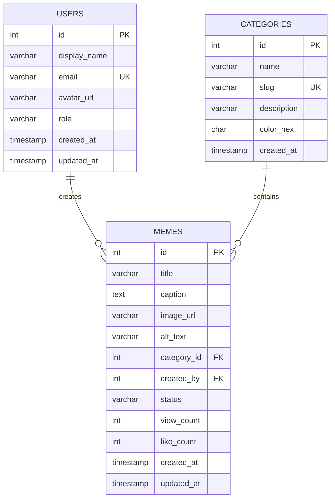

# โครงสร้างฐานข้อมูล Meme Hub

ระบบใช้ฐานข้อมูล MySQL/MariaDB ชื่อ `meme_hub` โดยมี 3 ตาราง รวม 25 ฟิลด์ และใช้ InnoDB เพื่อรองรับ Foreign Key

## ER Diagram

## ตาราง `users` - 7 ฟิลด์
| ฟิลด์ | ชนิดข้อมูล | คีย์/ข้อกำหนด | ความหมาย |
|---|---|---|---|
| id | INT UNSIGNED | PK, AUTO_INCREMENT | รหัสผู้ใช้ |
| display_name | VARCHAR(100) | NOT NULL | ชื่อที่แสดง |
| email | VARCHAR(190) | UNIQUE, NOT NULL | อีเมล |
| avatar_url | VARCHAR(500) | NULL | URL รูปโปรไฟล์ |
| role | VARCHAR(30) | NOT NULL, DEFAULT member | บทบาท |
| created_at | TIMESTAMP | DEFAULT CURRENT_TIMESTAMP | วันที่สร้าง |
| updated_at | TIMESTAMP | auto update | วันที่แก้ไขล่าสุด |

## ตาราง `categories` - 6 ฟิลด์
| ฟิลด์ | ชนิดข้อมูล | คีย์/ข้อกำหนด | ความหมาย |
|---|---|---|---|
| id | INT UNSIGNED | PK, AUTO_INCREMENT | รหัสหมวดหมู่ |
| name | VARCHAR(80) | NOT NULL | ชื่อหมวดหมู่ |
| slug | VARCHAR(100) | UNIQUE, NOT NULL | ชื่อย่อสำหรับ URL |
| description | VARCHAR(255) | NULL | รายละเอียด |
| color_hex | CHAR(7) | NOT NULL, DEFAULT #7C5CFC | สีป้ายหมวดหมู่ |
| created_at | TIMESTAMP | DEFAULT CURRENT_TIMESTAMP | วันที่สร้าง |

## ตาราง `memes` - 12 ฟิลด์
| ฟิลด์ | ชนิดข้อมูล | คีย์/ข้อกำหนด | ความหมาย |
|---|---|---|---|
| id | INT UNSIGNED | PK, AUTO_INCREMENT | รหัสมีม |
| title | VARCHAR(150) | NOT NULL | ชื่อมีม |
| caption | TEXT | NOT NULL | คำบรรยาย/แคปชัน |
| image_url | VARCHAR(1000) | NOT NULL | ที่อยู่รูปภาพ |
| alt_text | VARCHAR(255) | NULL | ข้อความอธิบายรูปภาพ |
| category_id | INT UNSIGNED | FK → categories.id | หมวดหมู่ของมีม |
| created_by | INT UNSIGNED | FK → users.id | ผู้สร้างมีม |
| status | VARCHAR(20) | NOT NULL, DEFAULT published | published หรือ draft |
| view_count | INT UNSIGNED | DEFAULT 0 | จำนวนการเข้าชม |
| like_count | INT UNSIGNED | DEFAULT 0 | จำนวน likes |
| created_at | TIMESTAMP | DEFAULT CURRENT_TIMESTAMP | วันที่สร้าง |
| updated_at | TIMESTAMP | auto update | วันที่แก้ไขล่าสุด |

## ความสัมพันธ์
- `categories (1) -> (หลาย) memes`: หมวดหมู่หนึ่งมีมีมได้หลายรายการ และ `memes.category_id` อ้างถึง `categories.id`
- `users (1) -> (หลาย) memes`: ผู้ใช้หนึ่งคนสร้างมีมได้หลายรายการ และ `memes.created_by` อ้างถึง `users.id`
- `ON DELETE RESTRICT` ป้องกันลบหมวดหมู่/ผู้ใช้ที่ยังถูกใช้โดยมีม และ `ON UPDATE CASCADE` อัปเดตรหัสอ้างอิงเมื่อมีการเปลี่ยนคีย์

## การออกแบบเพื่อความปลอดภัย
- การเพิ่ม/แก้ไข/ลบใช้ prepared statements
- Escape output HTML เพื่อป้องกันการแทรก script ในข้อความ
- การลบต้องเป็น POST request และตรวจสอบ CSRF token
- มีการตรวจสอบรูปภาพให้เป็น path ภายใน `assets/` หรือ URL ที่ใช้ HTTP/HTTPS
